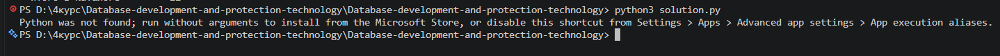
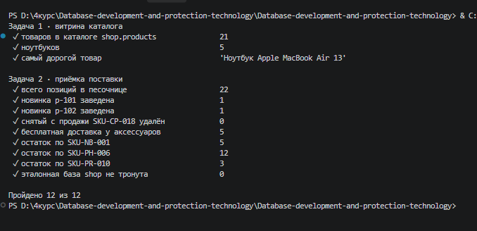
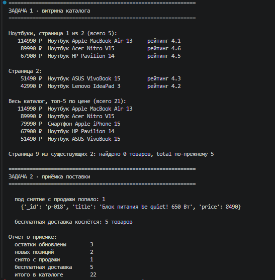
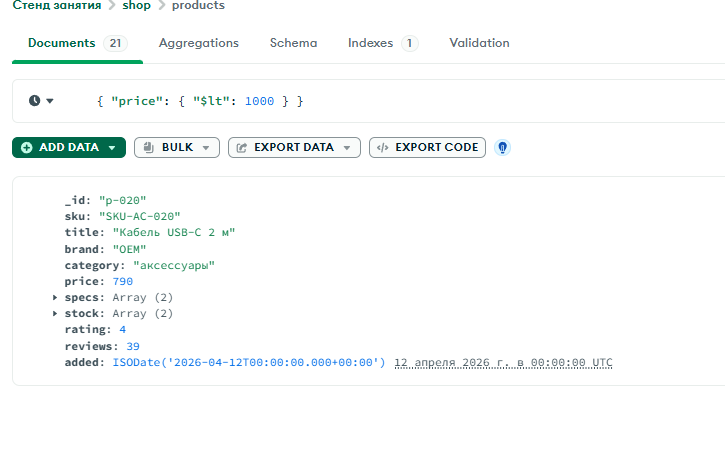
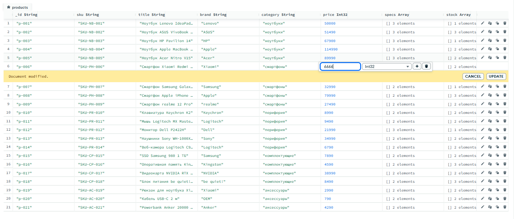
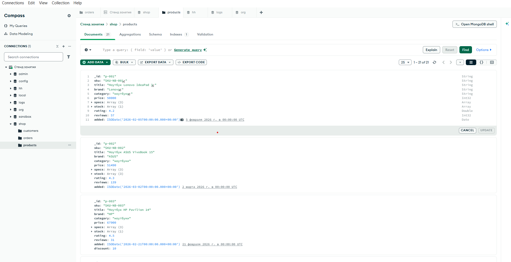

# Домашнее задание № 3 · «Каталог товаров»

**ФИО:** ...
**Группа:** ...
**Дата:** ...

### Среда выполнения

- ОС: Windows
- Язык и версия: Python 3.x (pymongo)
- MongoDB / Compass: MongoDB 7 (стенд курса в Docker) / Compass 1.53.0
- База данных: `shop` (чтение), `sandbox` (изменения)
- Коллекция: `products`
- Команда запуска: `python solution.py`

Выбранный вариант запуска: Python на своём компьютере, сервер — стенд курса в Docker.

### Результаты

Стенд сброшен до чистых данных (`docker compose run --rm reset`: 21 товар, 120 заказов).
Программа подключается к `mongodb://localhost:27017`, показывает каталог ноутбуков
постранично (в `shop.products` 5 ноутбуков, самый дорогой — Apple MacBook Air 13,
страница за пределами данных возвращает пустой список, `total` остаётся 5) и проводит
приёмку поставки в `sandbox.products`: обновлены остатки трёх артикулов, заведены две новинки
(`p-101`, `p-102`), снят с продажи `SKU-CP-018`, пяти аксессуарам выставлена бесплатная доставка.
Итого в песочнице 22 товара. Повторный запуск не создаёт дублей: новинки упираются в `E11000`
и пропускаются.

### Скриншоты

1. Запуск: 
2. Создание товаров: 
3. Каталог: 
4. Поиск: 
5. Изменение/удаление: 
6. Проверка в базе: 

### Ответы на вопросы

**1. Какие поля есть у документа товара? Какие поля должны иметь числовой тип и почему цену и количество нельзя хранить строками?**

У товара есть `_id`, `sku`, `title`, `brand`, `category`, `price`, `specs` (массив строк),
остатки (`stock` или `qty_total`), `rating`, `reviews` и дата `added`. Числовыми должны быть `price`,
остатки, `rating` и `reviews`. Если хранить цену строкой, сравнение `{ price: { $gt: 50000 } }`
не найдёт строку `"65000"`, а сортировка пойдёт по символам: `"9000"` окажется больше `"42990"`.
Оператор `$inc` для остатков тоже работает только с числами, со строкой он выдаст ошибку.

**2. Чем обычное чтение коллекции отличается от поиска по условию? Приведите пример из своей работы.**

Обычное чтение (`find({})`) возвращает все документы, а поиск принимает фильтр и отдаёт только
подходящие. В моей работе функция `catalog_page` без категории читает весь каталог, а с категорией
собирает фильтр `{"category": "ноутбуки"}` и возвращает пять ноутбуков. В `receive_delivery`
фильтр `{"sku": {"$in": ["SKU-CP-018"]}}` выбирает позиции для снятия с продажи, и перед
удалением я считаю их через `count_documents`, чтобы не удалить лишнего.

**3. Как вы проверили, что операция действительно изменила данные в MongoDB, а не только текст в интерфейсе программы?**

Результат операции я проверял в самой базе. В Compass открыл `sandbox.products` и убедился,
что документов стало 22, у `SKU-CP-018` документа нет, у новинок `p-101` и `p-102` есть записи,
а у аксессуаров появилось поле `free_shipping: true`. Остатки сверил по значению
`qty_total` у трёх артикулов. Отдельно проверил, что в эталонной базе `shop` поля `free_shipping`
нет, то есть правки ушли только в песочницу.

### Вывод

Я научился(ась) собирать страницу каталога с проекцией, сортировкой по двум ключам и подсчётом
`total` на сервере, а также менять данные через `$inc`, `insert_many`, `delete_many` и
`update_many`. Программа запускается и подключается к MongoDB на `localhost:27017`, повторный
запуск не ломает данные. В MongoDB проверено, что в песочнице 22 товара, остатки обновлены,
новинки заведены, снятый товар удалён, а эталонная база `shop` не тронута.